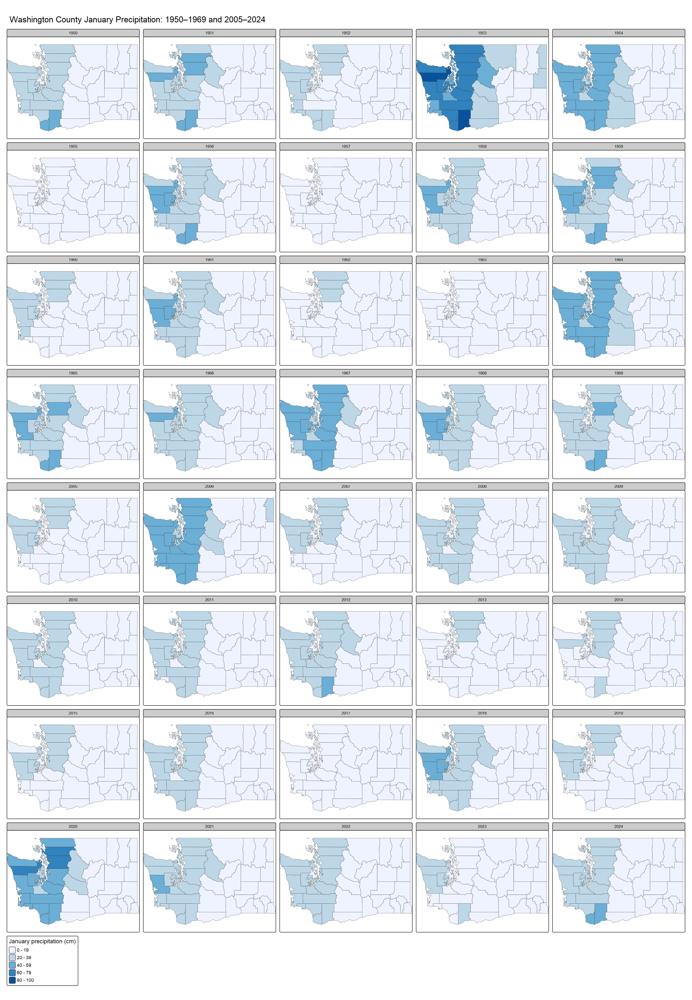

```{r setup, include=FALSE}
knitr::opts_chunk$set(echo = TRUE)
library(tidyverse)
library(sf)
library(tmap)
library(knitr)
```

## Confidence intervals

**Your name: {Emmanuel Mensah}**

**Overview:**

In this lab, we will create confidence intervals for January precipitation in Washington during two time periods: 1950-1969 and 2005-2024. Using county-level precipitation data from the ERA5 dataset, you will estimate statewide precipitation patterns, then examine variation and change at the county level. We've summed the precipitation in January for each county over two twenty year time periods: 1950-1969 and 2005-2024. You'll be using those data to create confidence intervals at a state and county level.

To load these data, load the csv file, which is included in the data folder:

```{r message=FALSE}
era5_data<-read_csv("data/precip_uswest_era5.csv")
```

This is a long format dataset including county identifiers, county population, median household income, and poverty rate. Census figures are based on the 2018-22 ACS. The last two columns (year, prcp_m, time_range) give the year and total precipitation in meters from the ERA5 NetCDF file, and two time ranges (1950-1969 and 2005-2024).

The script used to create this dataframe is also provided in this repository ('lab3_dataprep'), along with rasters of the yearly mean total precipitation for Januaries in the two time periods of interest.

For this lab to be marked complete, it must demonstrate the following learning standards:

* 11. Create effective data visualizations across multiple chart types (line, scatter, histogram, Q-Q plot), applying appropriate aesthetic choices such as color, grouping, and labeling. (Tasks 2 and 5)
* 12. Produce and interpret confidence interval plots that enable visual comparison of means and uncertainty across groups or time periods. (Tasks 2, 3, 5, and 6)
* 13. Visualize spatial data using appropriate mapping tools, selecting suitable classification schemes and cartographic elements to support clear communication. (Task 7)
* 14. Arrange and present tabular results in a readable format appropriate for a technical document or report. (Tasks 1 and 4)
* 15. Use measures of central tendency and dispersion to describe the variables in tabular datasets (Tasks 1 and 4)
* 20. Explaining how evidence from a sample supports conclusions about a population while acknowledging sampling variability and uncertainty. (Tasks 3 and 6)
* 22. Construct and interpret confidence intervals, explaining how factors such as sample size and spatial scale affect the precision of an estimate. (Tasks 1, 3, 4 and 6)


# Part 1: Calculating statewide confidence intervals for Washington's precipitation

In the first part of this lab, you'll determine a confidence interval for Washington's precipitation for these two time periods. This can be helpful in identifying whether precipitation has changed across the state (e.g., whether the two confidence intervals overlap) using the county data as your sample.

**Task 1** _Load the data and filter it to just include data for the state of Washington. Then create a table showing mean precipitation, standard deviation, number of observations (sample size), and upper/lower confidence interval bounds for each of the two time periods in the `time_range` field. Use `kable` to display the table when you are done._

```{r Task1}
# Filter the data to Washington
Washington <- era5_data %>%
  filter(st_name == "Washington")

# Calculate mean, standard deviation and standard error
WA_summary <- Washington %>%
  group_by(time_range) %>%
  summarise(
    prcp_mean = mean(prcp_m),
    prcp_sd = sd(prcp_m),
    n = n(),
    se = prcp_sd / sqrt(n)
  )

# Get the z-score for a 95% confidence interval
z.score <- qnorm(0.975)

# Calculate the margin of error and confidence intervals
WA_summary <- WA_summary %>%
  mutate(
    error = z.score * se,
    ci_high = prcp_mean + error,
    ci_low = prcp_mean - error
  )

# Display the table
kable(WA_summary, digits = 4)

```

Using the code provided in class, create a ggplot graphic that visualizes these two confidence intervals. You'll want to use `geom_point` and `geom_linerange` to do so. Use the two years as the y-axis and mean precipitation as the x axis. Vary the color and position of the dots and lines for the mean/CI by the `time_range` variable. Feel free to also experiment with axis labels/themes to make the graph more appealing and accessible.

**Task 2** _Create a ggplot graphic as described above to show the confidence intervals for precipitation in Washington for each time range._

```{r Task3}
ggplot(WA_summary) +
  geom_linerange(
    aes(xmin = ci_low, xmax = ci_high,
        y = "Washington", color = time_range,
        group = time_range),
    position = position_dodge(width = 0.5),
    linewidth = 1.2
  ) +
  geom_point(
    aes(x = prcp_mean, y = "Washington",
        color = time_range, group = time_range),
    position = position_dodge(width = 0.5),
    size = 3
  ) +
  labs(
    title = "January Precipitation in Washington",
    x = "Mean January Precipitation (m)",
    y = "State",
    color = "Time Period"
  ) +
  theme_minimal()

```

**Task 3** _Interpret your table and graph. What do they tell us about the change in Washington's precipitation during this time?_

{Washington got more January precipitation in 1950-1969 (red dot, about 0.203 m) than in 2005-2024 (blue dot, about 0.167 m), a drop of roughly 0.037 m. The horizontal lines are 95% confidence intervals. They don’t overlap, so the difference is probably real and not noise. January has been drier lately. That could affect water supply, agriculture, and river flows, but the graph doesn’t show whether it actually did.}

# Part 2: Analyzing county data in Washington.
In part 1, you ran a state level analysis. What if you wanted to identify where populations might be negatively affected by precipitation changes within a state? In this section, you'll look at the changes in precipitation **at county level** in Washington to 

To start with, adapt your code from step 1 so that you create confidence intervals for **counties** instead of states. After creating that dataset, create another ggplot graph of those confidence intervals that you can compare to the state level data in Task 2 to examine how precipitation has changed across counties in Washington.

**Task 4** _Create a summary table for January precipitation in Washington counties for both time periods. Use the same approach as in Task 1, but calculate statistics for counties rather than the state as a whole. Call the head of your table with `kable` when you are done._

```{r Task5}
# Like the state summary in Task 1, but grouped by county AND period
WA_county_summary <- Washington %>%
  group_by(cty_fips, cty_name, time_range) %>%
  summarise(
    prcp_mean = mean(prcp_m),
    prcp_sd = sd(prcp_m),
    n = n(),
    se = prcp_sd / sqrt(n),
    .groups = "drop"
  )

# Use the same 95% z-score calculated in Task 1
WA_county_summary <- WA_county_summary %>%
  mutate(
    error = z.score * se,
    ci_high = prcp_mean + error,
    ci_low = prcp_mean - error
  )

# First six rows of the county-level table
kable(head(WA_county_summary), digits = 4)
```

**Task 5** _Visualize the confidence intervals for the county-level data you generated in task 4, similar to task 2 above. In this case, counties should be the y axis and precip is the x axis. Each county will have two confidence intervals, one for each time period. For an optional extra challenge, visually highlight the counties where the confidence intervals between time periods do NOT overlap._

```{r Task6}
# As in the class example, geom_linerange shows the CI and geom_point shows the mean. Each period has its own color.
ggplot(
  WA_county_summary %>%
    mutate(county = str_remove(cty_name, " County, Washington"))
) +
  geom_linerange(
    aes(
      xmin = ci_low, xmax = ci_high,
      y = reorder(county, prcp_mean),
      color = time_range, group = time_range
    ),
    position = position_dodge(width = 0.6),
    orientation = "y",
    linewidth = 0.65
  ) +
  geom_point(
    aes(
      x = prcp_mean,
      y = reorder(county, prcp_mean),
      color = time_range, group = time_range
    ),
    position = position_dodge(width = 0.6),
    size = 1.8
  ) +
  labs(
    title = "January precipitation in Washington counties",
    subtitle = "County means and 95% confidence intervals",
    x = "Mean January precipitation (m)",
    y = "County",
    color = "Time period"
  ) +
  theme_minimal()
```

**Task 6**: _Compare the size of the error terms for your county level data to the error terms at state level that you calculated in Task 1. Are they bigger or smaller? Explain why the formula you used for calculating the error terms produced error terms of different sizes. How is this difference visible in your ggplot graphs?_

{County-level margins of error are generally larger than the statewide margins. For 1950 to 1969, the statewide margin is about 0.0110 m, and the average county margin is 0.0390 m. For 2005 to 2024, the values are about 0.0086 m and 0.0279 m. The main reason is that the statewide calculation pools 780 county-year observations per period, while each county has only 20. In the formula, se = sd / sqrt(n), a smaller n gives a larger standard error when the standard deviation stays similar. Since error = z.score * se, a larger standard error widens the confidence interval, which shows up in the graphs as longer horizontal lines for the county estimates. Sample size is not the only factor, because the standard deviations also differ. The statewide calculation also treats county-year records as independent even though they may be correlated, so its precision may be overstated.}

**Task 7**: _Transform the county data from task 4 into wide format so that the means for each time period are in the same row for each county. Then calculate the change in precipitation between the time periods. Join this table to the geopackage file that contains county boundaries and census data, making sure that you only have Washington counties included - use the geopackage `data/acsdata_cty_westreg.gpkg`. Then use `tmap` to map out the difference in precipitation means across the two time periods. Make sure the legend of this map is interpretable._

```{r Task7}
# Putting both period means on one row for each county
WA_county_wide <- WA_county_summary %>%
  select(cty_fips, cty_name, time_range, prcp_mean) %>%
  pivot_wider(
    names_from = time_range,
    values_from = prcp_mean
  )

# Recent period minus earlier period; negative = a decrease
WA_county_wide <- WA_county_wide %>%
  mutate(
    change_m = `2005-24` - `1950-69`,
    change_cm = change_m * 100,
    cty_fips = as.character(cty_fips)
  )

# Load the county polygons and keep Washington only
WA_boundaries <- st_read(
  "data/acsdata_cty_westreg.gpkg", quiet = TRUE
) %>%
  filter(st_name == "Washington") %>%
  mutate(cty_fips = as.character(cty_fips))

# Join the table to the spatial polygons using county FIPS
WA_map <- WA_boundaries %>%
  left_join(
    WA_county_wide %>% select(cty_fips, change_m, change_cm),
    by = "cty_fips"
  )

# I use chatGPT to Confirm the join, one map feature per WA county, no missing changes
stopifnot(nrow(WA_map) == 39, !anyNA(WA_map$change_cm)) 


# Map the difference in mean January precipitation
tmap_mode("plot")

tm_shape(WA_map) +
  tm_polygons(
    fill = "change_cm",
    fill.scale = tm_scale_intervals(
      n = 6,
      style = "pretty",
      values = "-brewer.blues"
    ),
    fill.legend = tm_legend(
      title = "Change in precipitation (cm)"
    )
  ) +
  tm_borders(lwd = 0.5) +
  tm_title(
    "Washington: Change in Mean January Precipitation, 1950–69 to 2005–24"
  )
```


# Optional challenge section: Interpreting the implications of precipitation changes

Now that you've calculated these means and confidence intervals, let's identify who might be most affected by changes in precipitation. To see who is affected, create a dummy variable that flags any counties with a decline of 5 centimeters or more (0.05 meters) with a 1, labeling all other counties with a 0. Use group_by and summarise to do the following:

* Count the total population in each of these two county groups.
* Calculate the mean value for median income and poverty rate in these two groups.

**Task 8** _Create a dummy variable for counties with a change of 0.05 meters or more between the time periods. Calculate how many people currently live in these counties along with the mean value of median income (medinc) and poverty rate (pov_pop_pct) for those areas._

```{r Task 10}
WA_impact <- WA_map %>%
  st_drop_geometry() %>%
  mutate(
    # 1 = decline of at least 0.05 m (5 cm); 0 = smaller decline
    decline_5cm = if_else(change_m <= -0.05, 1, 0)
  )

WA_impact_summary <- WA_impact %>%
  group_by(decline_5cm) %>%
  summarise(
    counties = n(),
    total_population = sum(totpop_race, na.rm = TRUE),
    mean_median_income = mean(medinc, na.rm = TRUE),
    mean_poverty_pct = mean(pov_pop_pct, na.rm = TRUE),
    .groups = "drop"
  )

kable(WA_impact_summary, digits = 2)
```

**Task 9** _Create a one paragraph summary of your results from tasks 7 and 8. What do you learn about how precipitation has changed in the last 70 years across the state of Washington? How would you describe the population affected by large drops in precipitation based on your results?_

{The results from Tasks 7 and 8 show that average January precipitation decreased across all 39 counties in Washington between 1950–1969 and 2005–2024. However, the amount of decrease was different across counties. Skamania, Mason, and Jefferson counties experienced some of the largest decreases. Out of the 39 counties, 15 had precipitation declines of at least 5 cm, affecting areas where approximately 3.37 million people lived, based on the 2018–2022 ACS population estimates. These 15 counties had an average median household income of $76,272 and an average poverty rate of 11.38%, compared to $70,041 and 12.99% in the other 24 counties. This shows that counties with larger precipitation decreases generally had higher incomes and lower poverty rates. Although many people live in areas experiencing greater precipitation declines, the results do not necessarily mean that these changes have directly affected their livelihoods.}


Small multiples or multi-panel maps are often a helpful way to show change over time. See this page for more information about how these are created in `tmap`:

* https://r-tmap.github.io/tmap/articles/basics_facets

Using these tools, create a small multiples map of your precipitation data for counties in a state of your choice for all 40 years in these two time periods. This means you will have one figure with 40 individual maps, all of the same state in different years. These maps should allow easy comparison across years and should be clearly labeled so that they could be interpreted by someone with no knowledge of this assignment. 

In addition, describe two interesting trends you see in the figure you created.

```{r challenge, dpi=300}
# One January map for each of the 40 years (1950-69 and 2005-24)
WA_yearly <- Washington %>%
  mutate(
    cty_fips = as.character(cty_fips),
    year_label = substr(as.character(year), 1, 4),
    prcp_cm = prcp_m * 100
  ) %>%
  select(cty_fips, year_label, prcp_cm)

# Join one observation per county-year to the WA county geometry
WA_year_map <- WA_boundaries %>%
  select(cty_fips) %>%
  left_join(WA_yearly, by = "cty_fips") %>%
  mutate(year_label = factor(year_label, levels = sort(unique(year_label))))

# Verify there are 40 separate yearly panels
stopifnot(n_distinct(WA_year_map$year_label) == 40)

# A shared color scale makes the years directly comparable
tmap_mode("plot")

WA_40_maps <- tm_shape(WA_year_map) +
  tm_polygons(
    fill = "prcp_cm",
    fill.scale = tm_scale_intervals(
      n = 6,
      style = "pretty",
      values = "brewer.blues"
    ),
    fill.legend = tm_legend(
      title = "January precipitation (cm)"
    ),
    fill.free = FALSE
  ) +
  tm_borders(lwd = 0.2) +
  tm_facets_wrap(
    by = "year_label",
    ncol = 5,
    free.coords = FALSE
  ) +
  tm_title(
    "Washington County January Precipitation: 1950–1969 and 2005–2024"
  ) +
  tm_layout(
    asp = 0,
    outer.margins = c(0.01, 0.01, 0.01, 0.01),
    inner.margins = c(0, 0, 0, 0)
  )

# Save to a larger image instead of the small RStudio plot window
tmap_save(
  WA_40_maps,
  filename = "WA_40_year_precipitation.png",
  width = 18,
  height = 26,
  units = "in",
  dpi = 160
)

# Display the saved map in your R Markdown document


```

{One interesting trend is that January precipitation varies considerably from year to year across Washington. For example, 1953 appears to be one of the wettest years, with darker blue colors showing higher precipitation, while years such as 1963 and 2017 appear much drier, with mostly lighter colors. This shows that January precipitation is not consistent every year. Another interesting trend is that western Washington generally receives more January precipitation than eastern Washington. Counties along the coast and in the western part of the state often have darker blue colors, while counties in eastern Washington are mostly lighter. The maps also suggest that January precipitation was generally higher during 1950–1969 than during 2005–2024, although some recent years, such as 2020, still experienced relatively high precipitation.}


# Final submission stuff

**Disclosure of assistance:** Besides class materials, what other sources of assistance did you use while completing this lab? These can include input from classmates, relevant material identified through web searches (e.g., Stack Overflow), or assistance from ChatGPT or other AI tools. How did these sources support your own learning in completing this lab?

{I use chatGPT to Confirm the join, one map feature per WA county, no missing changes in Lab 7, and also the video lecture was very helpful.}

**Lab reflection:** How do you feel about the work you did on this lab? Was it easy, moderate, or hard? What are the biggest things you learned by completing it?

{I found the lab interest. The confidence interval calculations were easier to follow because they used the same sequence of `group_by()`, `summarise()`, `qnorm()`, and `mutate()` as in class. The harder part was rearranging the county data and joining it to the map. I learned that confidence intervals show uncertainty around an estimated mean, that smaller sample sizes generally produce wider intervals, and that precipitation changes can vary considerably among counties. The maps helped make those geographic differences easier to interpret.}
